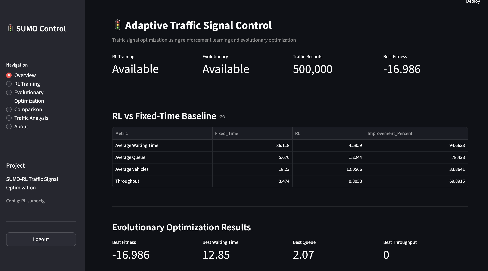
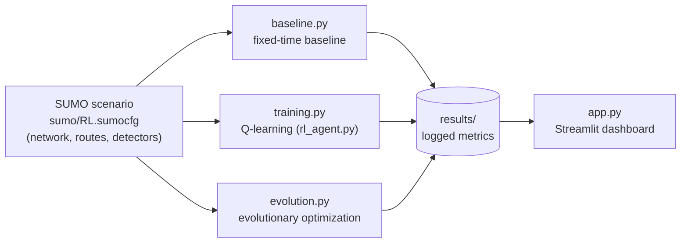
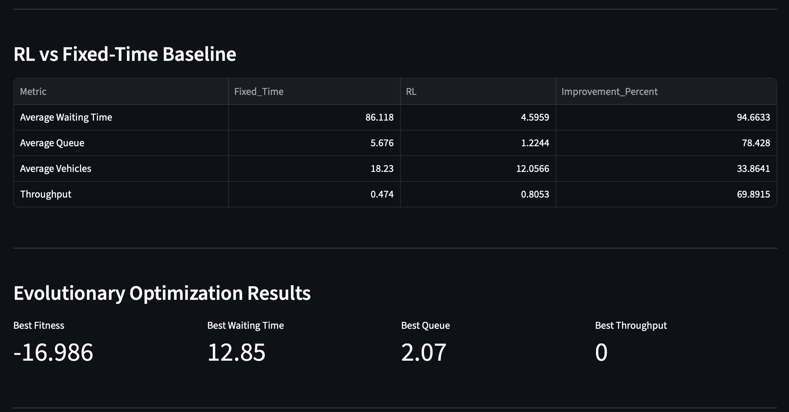
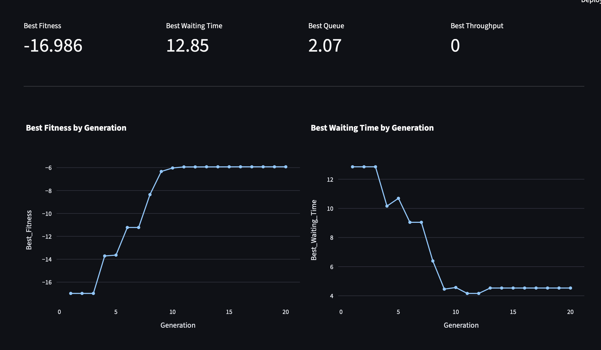
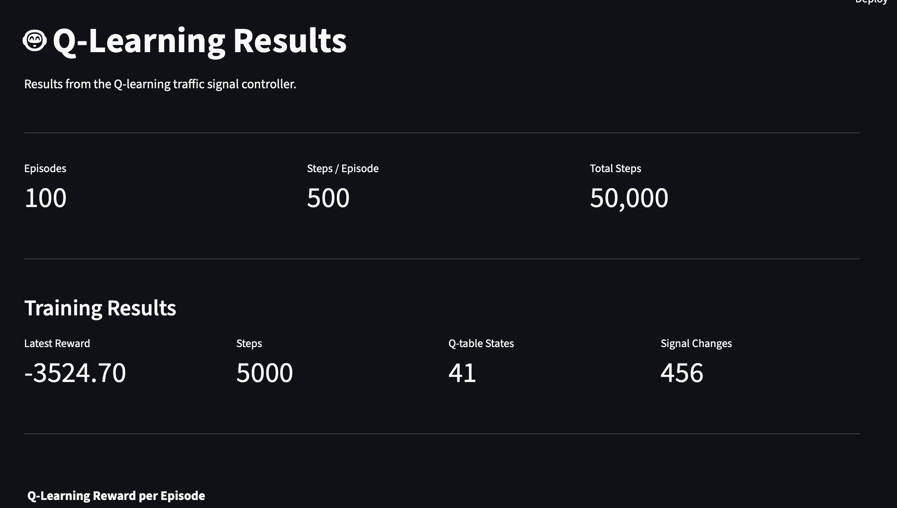
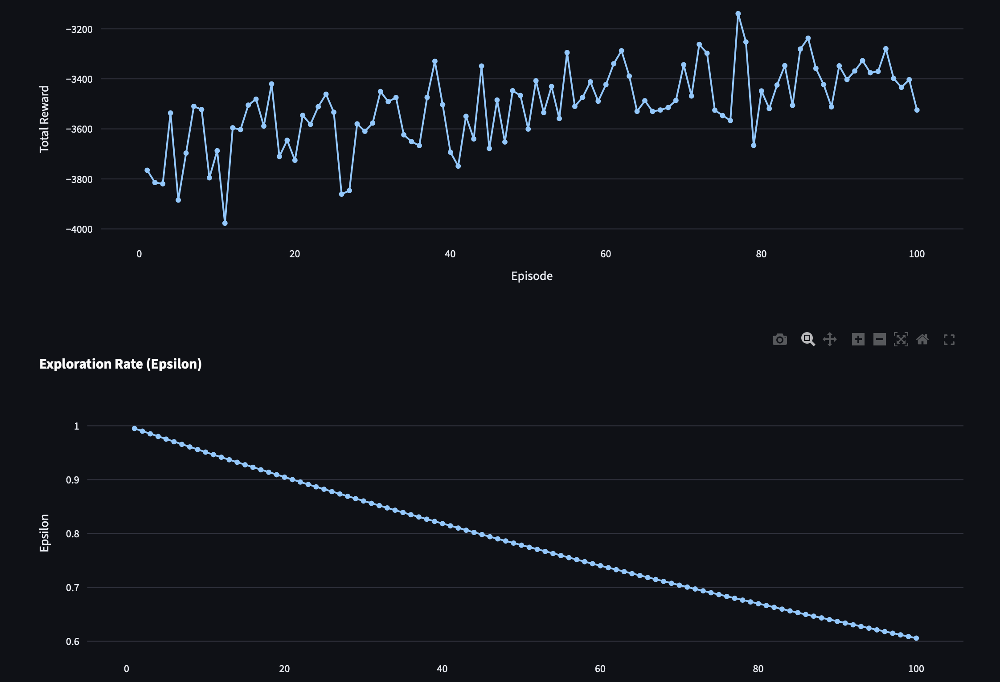
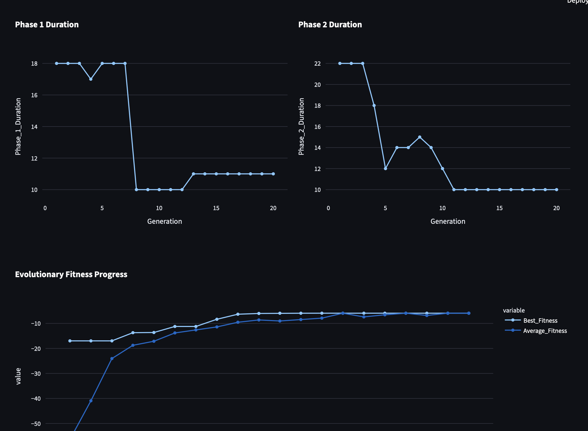
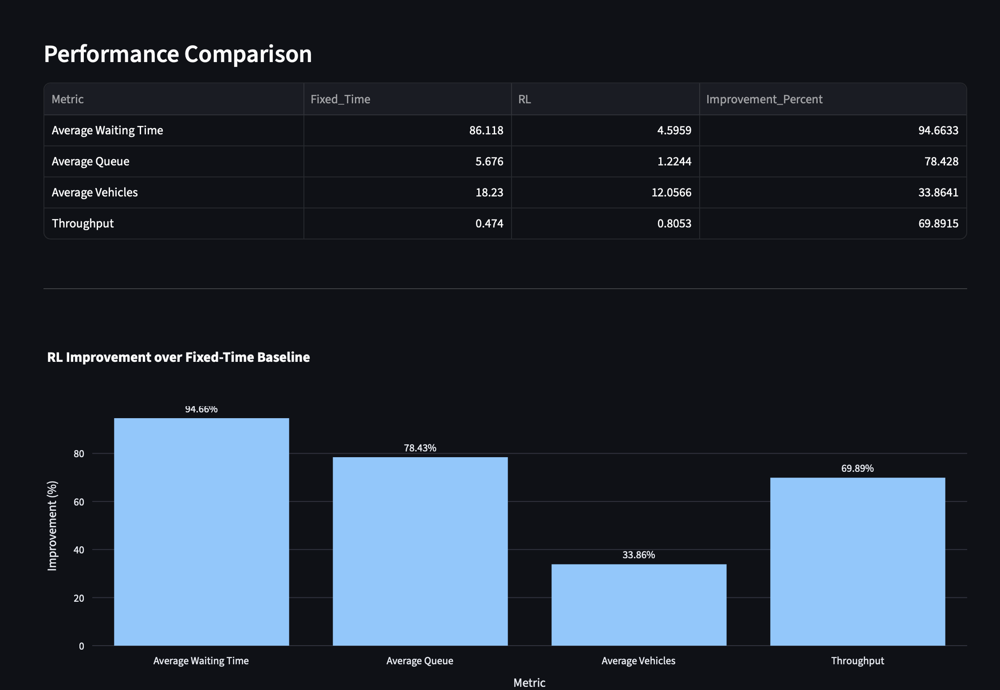
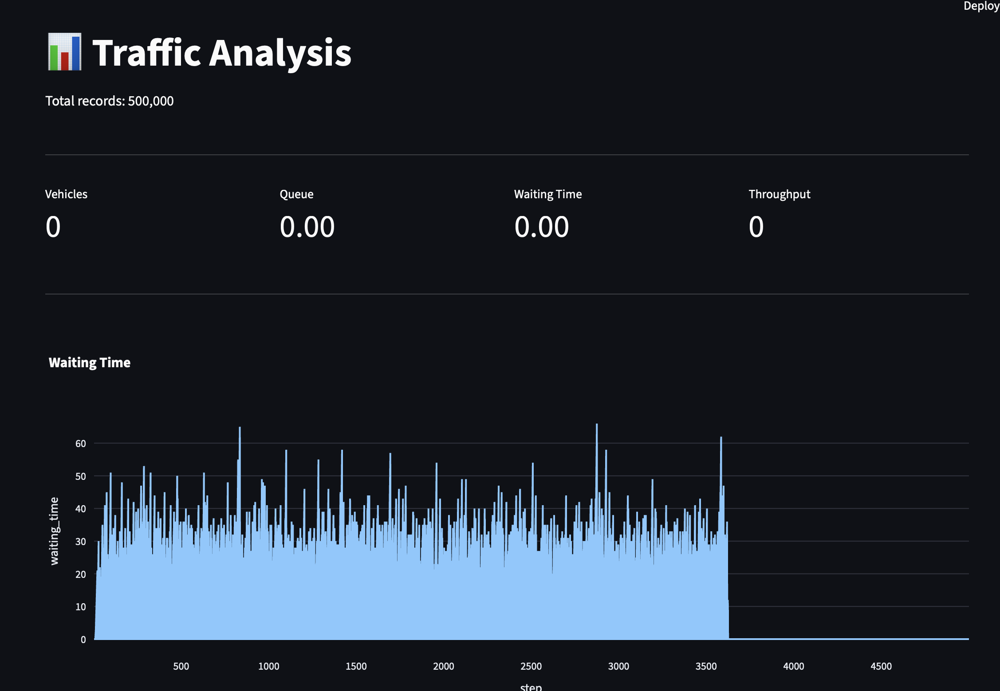

# 🚦 SUMO RL Traffic Optimization Dashboard

**Adaptive traffic-signal control with Q-learning and evolutionary optimization, simulated in SUMO and explored through an interactive Streamlit dashboard.**




---

## Table of contents

- [Overview](#overview)
- [Headline results](#headline-results)
- [How it works](#how-it-works)
- [Dashboard tour](#dashboard-tour)
- [Project structure](#project-structure)
- [Getting started](#getting-started)
- [Troubleshooting (macOS)](#troubleshooting-macos)
- [Metrics tracked](#metrics-tracked)
- [Limitations and future work](#limitations-and-future-work)
- [Acknowledgements](#acknowledgements)
- [Author](#author)

---

## Overview

Fixed-time traffic lights cycle through the same plan no matter how much traffic is waiting. This project asks a simple question: **can a learned or optimized signal plan do better?**

It uses the [SUMO](https://eclipse.dev/sumo/) (Simulation of Urban Mobility) traffic simulator, controlled from Python through TraCI, to compare three ways of running a signalised intersection:

| Approach | What it does |
|---|---|
| **Fixed-time baseline** | A standard fixed signal plan, used as the reference point. |
| **Q-learning agent** | A reinforcement-learning agent that learns from experience when to hold or change the signal. Trained for 100 episodes. |
| **Evolutionary optimization** | An evolutionary search over 20 generations that tunes the signal phase durations. |

Every run is logged, and a multi-page Streamlit dashboard turns the results into KPIs, interactive Plotly charts, comparison tables and downloadable datasets.

## Headline results

Q-learning against the fixed-time baseline, as shown on the dashboard's Comparison page:

| Metric | Fixed-time | Q-learning | Change |
|---|---:|---:|---:|
| Average waiting time | 86.118 | 4.5959 | **94.66 % lower** |
| Average queue length | 5.676 | 1.2244 | **78.43 % lower** |
| Average vehicles in network | 18.23 | 12.0566 | **33.86 % lower** |
| Throughput | 0.474 | 0.8053 | **69.89 % higher** |

Evolutionary optimization, first generation compared with the best result after 20 generations:

| | Generation 1 | Best after 20 generations |
|---|---:|---:|
| Fitness (higher is better) | -16.986 | **-5.928** |
| Best waiting time | 12.85 | **4.532** |
| Best queue length | 2.07 | **1.198** |
| Phase 1 / Phase 2 duration | 18 / 22 | **11 / 10** |

> Results come from a single training run on the bundled single-intersection scenario. See [Limitations](#limitations-and-future-work).

## How it works



1. **Simulate.** `sumo_runner.py` starts SUMO and talks to it through TraCI, reading traffic state and setting signal phases.
2. **Learn and optimize.** `training.py` trains the Q-learning agent (`rl_agent.py`) over 100 episodes with a decaying exploration rate. `evolution.py` evolves phase durations over 20 generations. `baseline.py` runs the fixed-time plan.
3. **Log.** Each run writes its metrics to `results/`, including a traffic dataset of 500,000 records (100 episodes with about 5,000 simulator steps each).
4. **Explore.** `app.py` reads those results and presents them in the dashboard.

## Dashboard tour

The sidebar (**SUMO Control**) has six pages, a project card showing the active SUMO config (`RL.sumocfg`), and a **Logout** button.

### 1. Overview
Status of the RL and evolutionary results, the number of traffic records, the **RL vs Fixed-Time Baseline** table, and a summary of the evolutionary run.


### 2. RL Training
Training configuration (episodes, steps per episode, total steps), final training statistics (latest reward, steps, number of Q-table states, signal changes), and charts for **reward per episode**, **exploration rate (epsilon)** and **Q-table state growth**.




### 3. Evolutionary Optimization
Best fitness, waiting time, queue and throughput; how the **Phase 1** and **Phase 2 durations** evolve; **best and average fitness** per generation; and a full **Generation Results** table.



### 4. Comparison
The fixed-time vs Q-learning table, a bar chart of **percentage improvement** per metric, a side-by-side bar chart of raw values, and a **Download Comparison Results** button.



### 5. Traffic Analysis
Metrics and time-series charts over simulation steps (**waiting time**, **queue length**, **throughput**, **signal phase**) plus the full **Traffic Dataset** table (`episode`, `step`, `vehicles`, `queue`, `waiting_time`, `average_speed`, `phase`, `throughput`) with a **Download Traffic Dataset** button.



### 6. About
A short description of the methods, the traffic metrics and the project files.




All charts are interactive Plotly figures: hover for exact values, zoom, pan, and export as PNG.

## Project structure

```
.
├── app.py                # Streamlit dashboard (multi-page, login-protected)
├── auth.py               # Login, password hashing, SQLite user store
├── config.py             # Paths and environment variables
├── sumo_runner.py        # SUMO / TraCI simulation interface
├── rl_agent.py           # Q-learning agent
├── training.py           # Q-learning training loop
├── baseline.py           # Fixed-time baseline simulation
├── evolution.py          # Evolutionary optimization of signal phase durations
├── evaluate.py           # Evaluation scripts
├── evaluate_rl.py
├── compare_results.py    # Comparison of baseline vs RL results
├── comparison.py
├── data_collector.py     # Traffic data logging
├── demo.py               # Demo run
├── sumo/                 # SUMO network, routes, detectors and RL.sumocfg
├── results/              # Generated training, evolution and traffic results
├── data/                 # Collected datasets
└── requirements.txt
```

## Getting started

### Prerequisites

- **Python 3.9 or newer**
- **Eclipse SUMO** (installed through pip below, or from the [official installer](https://eclipse.dev/sumo/))
- A modern browser

### 1. Clone the repository

```bash
git clone https://github.com/<your-username>/<repo-name>.git
cd <repo-name>
```

### 2. Create a virtual environment

```bash
python3 -m venv .venv
source .venv/bin/activate          # Windows: venv\Scripts\activate
```

### 3. Install the dependencies

```bash
pip install -r requirements.txt
```

### 4. Install SUMO and set `SUMO_HOME`

The simplest cross-platform route is the pip package, which bundles SUMO and its tools:

```bash
pip install eclipse-sumo traci sumolib
export SUMO_HOME=$(python -c "import sumo; print(sumo.SUMO_HOME)")
```

Check it with `sumo --version`. If you installed SUMO from the official installer or a package manager instead, point `SUMO_HOME` at its install folder (the one that contains `bin/` and `tools/`).

> `SUMO_HOME` must be set in the same terminal session you run the project from.

### 5. Set the administrator login

The dashboard is protected by a login. On first run an admin account is created in a local SQLite database (`traffic_system.db`, not committed to Git). Choose your own credentials before the first run:

```bash
export ADMIN_EMAIL=you@moi.gov.sa
export ADMIN_PASSWORD="choose-a-strong-password"
export ADMIN_NAME="Traffic Administrator"
```

Login emails must use the `@moi.gov.sa` domain. To change that, edit `MOI_EMAIL_DOMAIN` in `config.py`. If you set these variables after the database already exists, delete `traffic_system.db` and start again.

### 6. Generate the results

Skip this step if `results/` already contains data.

```bash
python baseline.py      # fixed-time baseline
python training.py      # Q-learning, 100 episodes
python evolution.py     # evolutionary optimization, 20 generations
```

### 7. Launch the dashboard

```bash
streamlit run app.py
```

Open <http://localhost:8501>, log in, and use the sidebar to move between pages.

### Starting it again later

```bash
cd <repo-name>
source venv/bin/activate
export SUMO_HOME=$(python -c "import sumo; print(sumo.SUMO_HOME)")
export ADMIN_EMAIL=you@moi.gov.sa ADMIN_PASSWORD="your-password" ADMIN_NAME="Traffic Administrator"
streamlit run app.py
```

## Troubleshooting (macOS)

| Symptom | Cause and fix |
|---|---|
| `zsh: command not found: sumo` | SUMO is not installed or not on your PATH. Run `pip install eclipse-sumo` inside the active virtual environment. |
| `brew link sumo` fails with `cxxstdlib_check` | The Homebrew SUMO tap can break on newer Homebrew versions. Use the pip install above instead. |
| `FXApp::openDisplay: unable to open display :0.0` | `sumo-gui` needs XQuartz. Either install [XQuartz](https://www.xquartz.org) and log out and in again, or run SUMO headless with the `sumo` binary (the dashboard has its own charts). |
| `Could not connect to TraCI server ... Connection refused` or `Connection closed by SUMO` | SUMO exited right after starting. Run the same `sumo -c sumo/RL.sumocfg ...` command by hand to see its error. On SUMO 1.28 the `--lateral-resolution 0` option crashed SUMO (exit code 247); removing it fixed the problem. |
| `No module named traci` | Run `pip install traci sumolib`, and make sure `SUMO_HOME` is set. |

## Metrics tracked

Queue length · waiting time · average speed · throughput · number of vehicles · traffic-signal phase

## Limitations and future work

- **Single intersection.** The bundled scenario controls one signalised intersection.
- **One scenario, one run.** The numbers above come from one training run on the bundled traffic demand. They show the approach works, not that it generalises. Repeating runs with several random seeds and different demand levels would give confidence intervals.
- **Tabular Q-learning.** The agent has a small Q-table (41 states in the reported run) and its reward curve is still noisy. Exploration decays slowly (about 1.0 to 0.6 over 100 episodes), so longer training or a faster decay may help.

Ideas for next steps:

- Multi-intersection networks and coordinated signals
- Deep RL (DQN, PPO) as a comparison against tabular Q-learning
- Evaluation under different demand profiles and emergency-vehicle scenarios
- Live simulation controls inside the dashboard

## Acknowledgements

- [Eclipse SUMO](https://eclipse.dev/sumo/) and its TraCI interface for the traffic simulation.
- [Streamlit](https://streamlit.io), [Plotly](https://plotly.com/python/) and [pandas](https://pandas.pydata.org) for the dashboard.
- This project was inspired by [mohammad-alowa/SUMO-RL-Dashboard](https://github.com/mohammad-alowa/SUMO-RL-Dashboard), which served as an initial reference for connecting SUMO to a Streamlit dashboard. This repository extends that idea considerably (fixed-time baseline, Q-learning training pipeline, evolutionary optimization, comparison analysis and a logged traffic dataset) and is developed and maintained independently.

## Author

**Khushi Jain** · GitHub: [@khushiJain312](https://github.com/khushiJain312)

Questions, suggestions and issues are welcome.